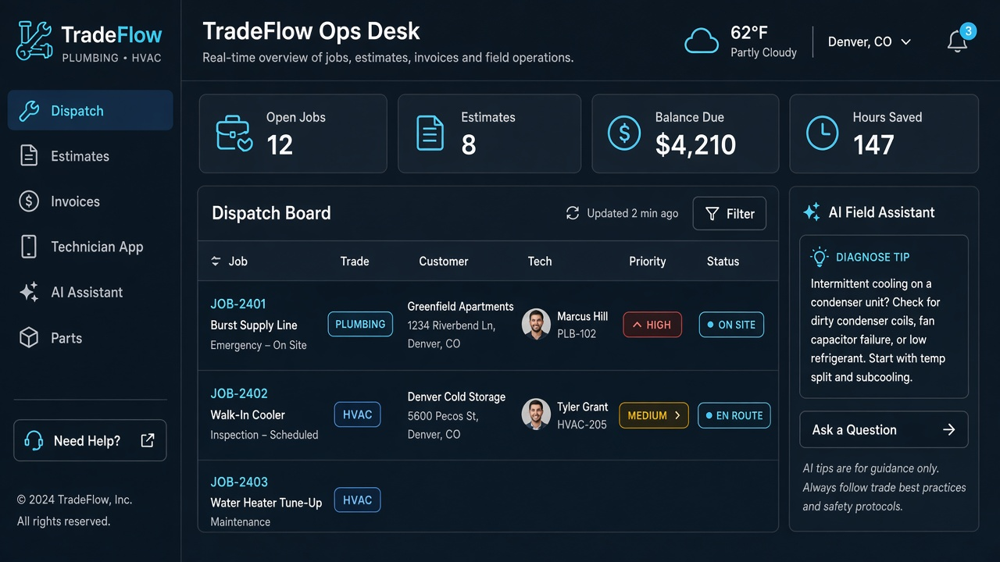

# Micro-SaaS for Plumbing, HVAC & Trades (TradeFlow)



**SEO title:** Micro-SaaS for Plumbing, HVAC & Trades — Dispatch, Estimates, Invoicing & Technician Apps  
**SEO description:** Micro-SaaS for plumbing, HVAC, and trades: dispatch, estimates, invoicing, technician apps, and AI assistants built for field service owners.

**Keywords:** plumbing SaaS, HVAC dispatch software, trades micro-SaaS, field service invoicing, technician mobile app, estimate software, job dispatch board, Laravel Filament trades

---

## Why this product

Generic CRMs ignore how plumbing and HVAC shops actually run: emergency callouts, seasonal tune-ups, truck stock, verbal approvals, and same-day invoices. **TradeFlow** is a modular micro-SaaS for trade owners — dispatch, estimates, invoicing, technician field tasks, plumbing/HVAC packs, and AI assistants — with toggles so shops enable only what they need.

### Business ROI / time saver

| Pain today | With TradeFlow |
|---|---|
| Whiteboard dispatch & phone trees | Dark-slate dispatch board with trade tags, ETA, priority |
| Estimates in Word / WhatsApp | Line-item estimates with deposits and conversion to invoices |
| Late or missing invoices | Job-linked invoicing with balance due + Unicode PDFs |
| Techs without a job queue | Technician app check-in, notes, parts used, completion % |
| Buying suites you never open | Modular on/off for plumbing, HVAC, AI, attendance |

**Demo model:** reclaim **~100+ hours/week** across enabled modules at a blended field-ops rate, surfaced on the public pricing page and admin widgets.

---

## Stack

- PHP Laravel (latest stable) + Filament admin (accent `#0F172A` dark slate)
- Modular feature flags (modules on/off; core ops modules protected)
- Multi-role users: Super Admin, Admin, Manager, Staff/Technician, Client/Customer, Demo
- Public marketing pages for features, modules, dispatch, estimates, pricing, demo
- Packagist packages from [imrandevbd](https://packagist.org/packages/imrandevbd/)

### Required packages

- `imrandevbd/drutogoti` — speed layer
- `imrandevbd/laravel-admin-panel` — admin panel foundations
- `imrandevbd/laravel-ai-catalog` — parts / supplier catalog scrape assist
- `imrandevbd/laravel-ai-hub` — AI field assistant wiring
- `imrandevbd/laravel-attendance-hub` — technician attendance bridge
- `imrandevbd/laravel-unicode-pdf` — multilingual estimate & invoice PDFs
- `imrandevbd/laravel-universal-slug` — Unicode-safe slugs for estimates, invoices, parts

**Laravel 13 note:** `drutogoti`, `laravel-admin-panel`, `laravel-attendance-hub`, and `laravel-ai-catalog` ship as path shims under `packages/*` that require `illuminate/support` `^11|^12|^13` so Composer resolves cleanly while all seven packages remain declared in `composer.json`.

---

## Modules (toggle on/off)

| Key | Module | Category | Core |
|---|---|---|---|
| `customers` | Customers & Properties | crm | Yes |
| `dispatch` | Dispatch Board | operations | Yes |
| `estimates` | Estimates & Quotes | sales | Yes |
| `invoicing` | Invoicing & Payments | finance | Yes |
| `technician_app` | Technician Field App | field | Yes |
| `plumbing_trade` | Plumbing Trade Pack | trade | No |
| `hvac_trade` | HVAC Trade Pack | trade | No |
| `ai_assistant` | AI Field Assistant | ai | No |
| `parts_catalog` | Parts & Catalog | inventory | No |
| `attendance_ops` | Technician Attendance | workforce | No (off by default) |
| `speed_optimizer` | Drutogoti Speed Layer | platform | No |
| `unicode_docs` | Unicode PDF Documents | documents | No |

---

## Domain features

- **Customers & properties** — residential/commercial accounts, access & equipment notes
- **Dispatch jobs** — trade type, priority, ETA, technician assignment, status pipeline
- **Estimates** — line items, tax, deposits, approval status, Unicode slugs
- **Invoices** — balance due, partial payments, PDF path, job linkage
- **Technician app** — check-in/out, field notes, parts used, completion %
- **AI assistant** — diagnose, estimate draft, customer SMS, job summary sessions
- **Parts catalog** — SKUs by trade with stock and supplier
- **Module toggles** — Filament module matrix + env defaults
- **Multi-role Filament admin** — `#0F172A` dark slate dashboard for trade owners

---

## Public pages

| Route | Purpose |
|---|---|
| `/` | Hero + KPIs + dispatch snapshot |
| `/features` | Feature catalog by module category |
| `/modules` | Full module toggle matrix |
| `/dispatch` | Live dispatch board table |
| `/estimates` | Estimates, invoices, parts |
| `/pricing` | ROI / pricing tiers |
| `/demo` | Demo credentials |
| `/admin` | Filament admin panel |

---

## Demo users

Password for all seeded users: `password` (or `DEMO_USER_PASSWORD`)

| Role | Email |
|---|---|
| Super Admin | `admin@tradeflow.test` |
| Admin | `ops@tradeflow.test` |
| Dispatch Manager | `dispatch@tradeflow.test` |
| Plumbing Technician | `tech@tradeflow.test` |
| HVAC Technician | `hvac@tradeflow.test` |
| Client | `client@tradeflow.test` |
| Demo | `demo@tradeflow.test` |

---

## Quick start

```bash
cp .env.example .env
composer install
php artisan key:generate
touch database/database.sqlite
php artisan migrate --seed
php artisan serve
```

Admin: http://localhost:8000/admin · Marketing: http://localhost:8000

### Docker

```bash
docker compose up -d --build
```

App on port `8080`, MySQL on `3307`.

---

## Author

**Imran Ahmed** · [imrandev.bd](https://imrandev.bd) · [me@imrandev.bd](mailto:me@imrandev.bd)

---

## 🤝 Let's Connect & Collaborate

I am open to Senior Remote Full-Stack Roles, AI Platform Architecture Contracts, and Enterprise Technical Advisory.

Timezone: UTC+6 (Dhaka / Rangpur, Bangladesh) — Flexible overlap with US, UK, and European business hours.

Delivery Mode: Async-ready, Slack, Discord, Jira, GitHub, and production-first accountability.

| Channel | Address / Handle | Quick Action |
|---|---|---|
| 🌐 Primary Portfolio | [imrandev.bd](https://imrandev.bd) | [Visit Site ↗](https://imrandev.bd) |
| 📦 Packagist Packages | [packagist.org/packages/imrandevbd/](https://packagist.org/packages/imrandevbd/) | [View Packages ↗](https://packagist.org/packages/imrandevbd/) |
| 💼 LinkedIn Profile | [linkedin.com/in/imranbru99](https://linkedin.com/in/imranbru99) | [Connect ↗](https://linkedin.com/in/imranbru99) |
| 🐙 GitHub Profile | [github.com/imranbru99](https://github.com/imranbru99) | [Follow ↗](https://github.com/imranbru99) |
| 💬 WhatsApp Direct | +880 1576-918420 | [Chat Now ↗](https://wa.me/8801576918420) |
| 📧 Direct Email | me@imrandev.bd | [Send Email ↗](mailto:me@imrandev.bd) |
| 🐦 X (Twitter) | [@imrandev_bd](https://x.com/imrandev_bd) | [Follow ↗](https://x.com/imrandev_bd) |
| 📺 YouTube Tech | [@ImranDevBD](https://youtube.com/@ImranDevBD) | [Subscribe ↗](https://youtube.com/@ImranDevBD) |
